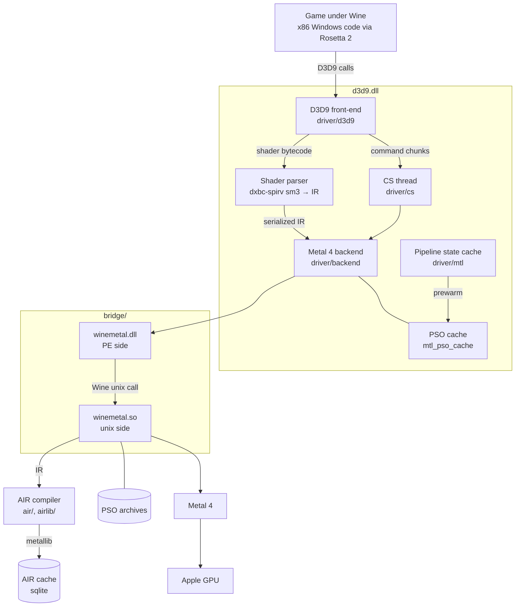
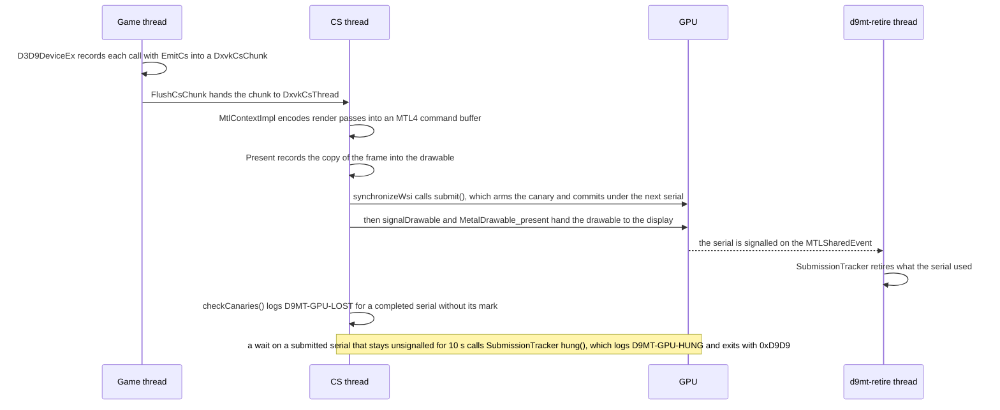

# d9mt

d9mt is a Direct3D 9 driver for Wine on Apple silicon that renders with Metal 4. A Windows game
loads it as its `d3d9.dll`, 32-bit or 64-bit, and d9mt turns the game's D3D9 calls into Metal
calls. There is no Vulkan or MoltenVK layer in between.

It joins DXVK's D3D9 front-end to a Metal 4 backend and a shader compiler of its own. The
compiler turns D3D9 shader bytecode into Apple's AIR, the LLVM bitcode inside a metallib, so
nothing compiles MSL at runtime. Metal calls cross from the game's Windows code to macOS through
a fork of DXMT's `winemetal` bridge.

Two free apps ship d9mt at a pinned commit:
[SWTOR on Mac](https://github.com/jdrly/swtor-on-mac) and
[SWGL on Mac](https://github.com/jdrly/swgl-on-mac). d9mt is an independent project, not
affiliated with or endorsed by the publishers or operators of any game it runs. All trademarks
belong to their owners.

This repository is a fork of [neo773/d9mt-v2](https://github.com/neo773/d9mt-v2), the successor
of [neo773/d9mt](https://github.com/neo773/d9mt). neo773 wrote both, archived the original and
permitted this fork. Their full history is in this repository. The fork adds 64-bit builds,
macOS 27 fixes, rendering fixes, persistent shader and pipeline caches, asynchronous shader
compilation and memory profiles.

## Status

d9mt is experimental. It has run three games:

- Star Wars: The Old Republic, 64-bit, this fork's main target. On an M5 Max it renders
  correctly and holds 60 fps with vsync at 4K.
- Star Wars Galaxies: Legends, 32-bit, on a community server.
- GTA IV, 32-bit, the game neo773 developed d9mt and d9mt-v2 against.

Nobody has tried other games yet. Expect them to reach code paths d9mt doesn't implement.

d9mt uses Metal 4 only: MTL4 command queues, allocators, argument tables, residency sets and
the MTL4 compiler. It has no Metal 3 path, so it needs macOS 26 or later. Most testing has been
on macOS 27.

### Recent fixes

- On macOS 26, Metal rejected every game shader, which left the screen black after the first
  loading screen. The AIR compiler had tagged its metallibs with macOS 27's AIR version, 2.9.
  It now writes the AIR 2.7 its bitcode declares on macOS 26 and keeps 2.9 on macOS 27, so
  Metal's shader caches there stay valid.
  [#110](https://github.com/jdrly/d9mt/pull/110)
- A DEFAULT-pool texture that the game sampled before writing it showed undefined memory. An
  M4 decoded it as magenta icons. d9mt now binds a null texture until the first write, and a
  player confirmed the fix on an M4 MacBook Air.
  [#105](https://github.com/jdrly/d9mt/pull/105)
- After a GPU hang, the game stayed frozen with its GPU context alive. Now a submitted command
  buffer that doesn't finish within 10 s ends the game with a `D9MT-GPU-HUNG` log line and exit
  code 0xD9D9. [#53](https://github.com/jdrly/d9mt/pull/53)
- A per-draw vertex upload could read past the end of a vertex buffer's CPU copy and
  page-fault. d9mt now clamps the copy from the first vertex the draw reads.
  [#57](https://github.com/jdrly/d9mt/pull/57)
- The GPU canary detects command buffers that the GPU dropped after a page fault and logs them
  as `D9MT-GPU-LOST`. It now marks every presented frame, scaled and MetalFX presents included.
  [#67](https://github.com/jdrly/d9mt/pull/67)

Three switches merged on 2026-10-30 and stay off by default until testers' measurements back
them. Under [ADR-0005](docs/adr/0005-correctness-first-speed-proven.md), a change made for speed
stays behind a switch until it renders identically on other Mac generations, a slower and a
fanless one among them.

- `D9MT_FLUSH_CAP=1` stops weak flush hints from submitting a command buffer mid-frame, as
  upstream DXVK does on tiling GPUs. [#113](https://github.com/jdrly/d9mt/pull/113)
- `D9MT_PSO_ASYNC_FLUSH=1` writes the Metal pipeline archive on a thread of its own. With the
  switch off, the pipeline build that makes a flush due writes it, usually on the render thread,
  which stalled for 0.5 to 0.67 s once per session in measured sessions.
  [#114](https://github.com/jdrly/d9mt/pull/114)
- `D9MT_COMPILE_MAXCONC=1` asks Metal to maximize concurrent pipeline compilation.
  [#117](https://github.com/jdrly/d9mt/pull/117)

### Known issues

- d9mt's bridge replaces the Wine engine's `winemetal`, which DXMT also uses for D3D10 and
  D3D11. DXMT games break on an engine with d9mt installed, so give d9mt a copy of the engine.
- The driver and the bridge have no version handshake. Install both from the same build, since
  a mismatched pair can crash.
- New areas stutter the first time while their shaders and pipelines compile. Compiles run on
  worker threads and go to disk caches, so later visits are smoother. `D9MT_ASYNC_SKIP=1` trades
  the stutter for pop-in, and `d9mt.pipelineWaitBudgetMs` caps it.
- The AIR cache and the pipeline archives have no size cap. The pipeline state cache keeps at
  most 1024 pipelines per game, about 390 KB.
- macOS 26 has had little testing. `scripts/test-air-versions.sh` checks that d9mt's metallibs
  carry the same version tags Apple's `metallib` writes for the same bitcode.
- A selector bug breaks MetalFX upscaling, `D9MT_METALFX`.
- d9mt ignores `SetGammaRamp`, so brightness sliders that use it do nothing.
- Code review found these unimplemented or unverified: instance divisors above 1, indexed
  triangle fans and stride-0 vertex streams. d9mt rejects hardware vertex shaders that address
  more than 256 float constants, as DXVK does.

## How it works



One frame, from the game's calls to the GPU and back:



The same stack as text:

```
YourGame.exe   32- or 64-bit Windows PE, x86 code under Rosetta 2
   │  loads
   ▼
d3d9.dll       this project, mingw PE: DXVK's D3D9 front-end + d9mt's Metal 4 backend
   │           shader bytecode → dxbc-spirv IR, serialized for the bridge
   ▼
winemetal.dll  this project, fork of DXMT's bridge, PE side, Wine builtin
   │  Wine unix call
   ▼
winemetal.so   this project, x86_64 Mach-O on Wine's unix side:
               IR → AIR (LLVM 15 bitcode) → metallib, shader and pipeline caches,
               Metal 4 command path  ──►  Metal  ──►  CAMetalLayer
```

The front-end in `driver/d3d9` is DXVK's D3D9 code with Vulkan removed. It tracks all D3D9
state and records work through DXVK's command-stream thread into the interface in `driver/mtl`.
[`driver/UPSTREAM`](driver/UPSTREAM) and [`driver/EXTRACTION-LOG.md`](driver/EXTRACTION-LOG.md)
record what came from DXVK and what changed.

The backend in `driver/backend` implements that interface on Metal 4. It owns the argument
tables, residency sets, command buffers and allocators, encoders, pipeline compilation, the
upload ring and presentation to the window's `CAMetalLayer`. Metal 4 command buffers don't
retain what they use, so every object lives until the GPU has finished the last command buffer
that uses it ([ADR-0001](docs/adr/0001-gpu-objects-live-until-retired.md)).

dxbc-spirv's `sm3` front-end parses the game's SM1 to SM3 shaders into dxbc-spirv's IR inside
`d3d9.dll`. The bridge carries the IR to Wine's unix side, where `airlib/` and `air/` lower it
to AIR with LLVM 15 and wrap it in a metallib that Metal loads directly. The fixed-function
pipeline uses DXVK's ubershaders, precompiled into a metallib that `d3d9.dll` embeds.

Three caches cut repeat compiles. The AIR cache is one sqlite file of compiled shaders, keyed
by the AIR codegen (the code that produces the metallibs), so only a change to that code makes
every player recompile once; other bridge changes keep it
([ADR-0006](docs/adr/0006-air-cache-keyed-on-codegen.md)). Metal 4 pipeline archives keep the
pipelines of the last 8 sessions. The pipeline state cache records which pipelines a game used
and rebuilds them in the background in later sessions, also after an update that invalidated
the other two ([docs/state-cache.md](docs/state-cache.md),
[ADR-0003](docs/adr/0003-pipeline-state-cache-in-d3d9.md)).

The bridge in `bridge/` is DXMT's `winemetal` plus vertex-descriptor pipelines, per-slot
samplers, vertex textures, the AIR compile calls and the Metal 4 command calls.
[`bridge/UPSTREAM`](bridge/UPSTREAM) lists the changes.

More depth:

- [CONTEXT.md](CONTEXT.md) defines the terms used in code, issues and docs.
- [docs/gpu-4k.md](docs/gpu-4k.md) analyses the GPU cost at 4K and the changes that cut it.
- [docs/g1-early-commit.md](docs/g1-early-commit.md) describes how a mid-pass flush commits
  earlier work without splitting the render pass.
- [docs/state-cache.md](docs/state-cache.md) and
  [docs/state-cache-journal.md](docs/state-cache-journal.md) cover the pipeline state cache.
- [docs/pso-key-hash.md](docs/pso-key-hash.md) covers the pipeline key's hash.
- [docs/adr/](docs/adr/index.md) holds the architecture decisions.
- `docs/dev-notes/` has neo773's notes from v2's development. They are historical and not
  maintained.

## Requirements

- An Apple silicon Mac on macOS 26 or later.
- Rosetta 2, because Wine's unix side, and `winemetal.so` with it, runs as x86_64.
- A Wine engine with an x86_64 unix side and the winemac hook DXMT's bridge uses,
  `macdrv_get_metal_layer`. d9mt's testing uses the CrossOver 24.0.7 engine. Nobody has tested
  upstream Wine. 32-bit games need 32-on-64 support, as CrossOver has.

## Build

You need Homebrew `bash` 4.3 or newer, `mingw-w64` for i686 and x86_64, `cmake`, `ninja`,
`python3` and the Xcode Command Line Tools. You need Xcode's Metal toolchain, `glslang` and
`spirv-cross` only to regenerate the embedded metallibs. The build needs no DXVK or DXMT
checkout and no Wine engine.

```bash
export PATH="/opt/homebrew/bin:$PATH"   # the scripts fail under /bin/bash 3.2

scripts/fetch-deps.sh             # dxbc-spirv at c5c1a5b9 with patches/dxbc-spirv applied
scripts/build-llvm-unixside.sh    # LLVM 15.0.7, static x86_64 libs; once, and slow
scripts/build-bridge.sh           # winemetal.so with the AIR compiler, winemetal.dll i386 + x86_64
ARCH=x64 scripts/build-driver.sh  # build/driver-x64/d3d9.dll for 64-bit games
ARCH=x86 scripts/build-driver.sh  # build/driver/d3d9.dll for 32-bit games
```

The driver and the bridge share an ABI, so rebuild and install them together. Two builds of
the same commit with the same toolchain give byte-identical binaries. The driver is about 80 MB
with debug info, so strip it before shipping. A binary release must carry the notices in
[THIRD_PARTY_NOTICES.md](THIRD_PARTY_NOTICES.md).

[docs/building.md](docs/building.md) covers the deployment target, the two metallib builds,
`D9MT_JOBS`, the bridge's smoke test and the strip commands.

## Install and run

Use a copy of the Wine engine for d9mt. Its bridge replaces the engine's `winemetal`, and DXMT
games stop working on that engine. Don't modify `/Applications/CrossOver.app` itself. It is
code-signed, and updates overwrite it.

1. Copy a Wine engine, for example CrossOver's `Contents/SharedSupport/CrossOver`, and call the
   copy `$ENGINE`.
2. Install the bridge into it. The script keeps the originals as `*.cx-orig`, and `--restore`
   puts them back.

   ```bash
   CX="$ENGINE" scripts/install-bridge-builtins.sh
   ```

3. Put the driver next to the game's `.exe` as `d3d9.dll`. The prefix's
   `drive_c/windows/system32/` works for a 64-bit game and `drive_c/windows/syswow64/` for a
   32-bit one.

   ```bash
   cp build/driver-x64/d3d9.dll "$GAME_DIR/d3d9.dll"   # 64-bit game
   cp build/driver/d3d9.dll     "$GAME_DIR/d3d9.dll"   # 32-bit game
   ```

4. Launch with `d3d9` overridden to the native DLL, using the engine from step 1.

   ```bash
   WINEDLLOVERRIDES="d3d9=n,b" "$ENGINE/bin/wine" --bottle "My Game" \
     start /unix "$GAME_DIR/YourGame.exe"
   ```

   `--bottle` is CrossOver's option. With plain Wine, set `WINEPREFIX` instead. The override
   can also go in `winecfg` under Libraries, or in a wrapper's DLL override setting.

To check that d9mt is active, set `DXVK_LOG_PATH=<dir>` and look for `<game>_d3d9.log`, or turn
on the Metal HUD with `MTL_HUD_ENABLED=1`.

## Configuration

d9mt reads DXVK's `dxvk.conf` next to the game's `.exe`, or the file `DXVK_CONFIG_FILE` names.
Environment variables take priority where both exist. Under CrossOver, environment variables
reach the game only through the bottle's `cxbottle.conf`, not through a shell `export`.

[docs/configuration.md](docs/configuration.md) lists every option and variable: memory
profiles, the pipeline wait budget, the attachment load/store optimization, the caches, the
frame cap, the GPU canary and the diagnostic switches such as `D9MT_PROFILE`.

## Tests

The hash suite is the correctness gate of every pull request. It runs the D3D9 test programs
in `test/code_*.c`, five frames each for most of them, and compares their frame hashes with the
base commit's, also under the Metal API validation layer and `D9MT_LIFETIME_CHECK=1`.
[docs/testing.md](docs/testing.md#hash-suite) names the programs that run elsewhere, end early
or differ from run to run. The suite's runner is on the branch `chore/test-runner` and not on
`main` yet.

The native unit tests need no Wine and no GPU:

```bash
scripts/run-native-tests.sh   # the 13 host clang++ tests in test/native/
scripts/test-upload-copy.sh   # UploadPerDrawData's clamp and copy under ASan/UBSan
```

`scripts/run-native-tests.sh` names the runner of each test it skips, and a test it doesn't know
fails the run. The state cache and compile-path tests also run under ThreadSanitizer.
[docs/testing.md](docs/testing.md) describes every runner, including the SM3 shader tests, the
AIR version test and the hang test under Wine.

## Performance

Correctness on every supported Mac comes first, and nothing measurably slower merges
([ADR-0005](docs/adr/0005-correctness-first-speed-proven.md)). [PERFORMANCE.md](PERFORMANCE.md)
is the method: paired ABBA rounds against a byte-identical control in a quiet window, a
code-layout control, the benchmarks in `test/perf/` and the `D9MT_PROFILE` diagnostics.

## Contributing

[CONTRIBUTING.md](CONTRIBUTING.md) has the issue and pull request format and the Definition of
Done. Read [CONTEXT.md](CONTEXT.md) and the [ADRs](docs/adr/index.md) first.

## Credits

- [neo773](https://github.com/neo773) wrote [d9mt](https://github.com/neo773/d9mt) and
  [d9mt-v2](https://github.com/neo773/d9mt-v2): the Metal 4 backend, the AIR shader compiler,
  the bridge extensions and the DXVK extraction this fork builds on.
- [DXVK](https://github.com/doitsujin/dxvk), by Philip Rebohle, Joshua Ashton and contributors,
  provides the D3D9 front-end and its fixed-function shaders.
- [DXMT](https://github.com/3Shain/dxmt), by Feifan He for CodeWeavers, provides the
  `winemetal` bridge that carries Metal calls across Wine's PE/unix boundary.
- [dxbc-spirv](https://github.com/doitsujin/dxbc-spirv), by Philip Rebohle, parses the shader
  bytecode into its IR.
- [LLVM](https://llvm.org) writes the AIR bitcode.
- [SPIRV-Cross](https://github.com/KhronosGroup/SPIRV-Cross) and
  [glslang](https://github.com/KhronosGroup/glslang) convert the fixed-function shaders at build
  time.
- Wine and CodeWeavers make the platform all of this runs on.
- Jan Drlý maintains the fork and did the x64, memory and rendering work.

## License

d9mt's own code and the DXVK-derived driver are under the zlib/libpng license
([LICENSE](LICENSE)), DXVK's license, with DXVK's copyright notice kept. `driver/` is an
altered version of DXVK, not the original.

The `winemetal` bridge in `bridge/` follows DXMT and is under the GNU LGPL 2.1 or later
([bridge/LICENSE](bridge/LICENSE), [bridge/COPYING.LIB](bridge/COPYING.LIB)).

[THIRD_PARTY_NOTICES.md](THIRD_PARTY_NOTICES.md) and [LICENSES/](LICENSES/) cover every
third-party component and what a binary release must ship.
